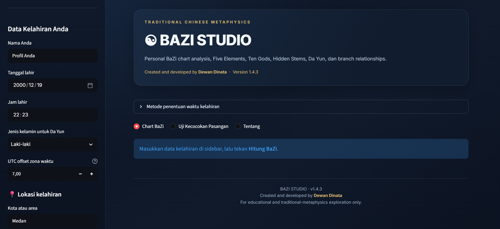

# ☯ BaZi Studio

### Discover Your Destiny Through the Art of BaZi

**BaZi Studio** is an interactive web application for exploring Chinese Four Pillars of Destiny (四柱命理), also known as BaZi. It transforms traditional metaphysical concepts into an accessible and structured digital experience.

Built with Python and Streamlit, BaZi Studio provides birth chart calculations, Five Elements analysis, and relationship compatibility insights through an elegant and interactive interface.

<p align="center">

  **Chart BaZi · Five Elements · Da Yun · Compatibility**

</p>

---

## ✨ Features

### 1. BaZi Birth Chart
Generate your personal Four Pillars of Destiny based on birth information.

- Year, Month, Day, and Hour Pillars
- Heavenly Stems (天干)
- Earthly Branches (地支)
- Hidden Stems (藏干)
- Day Master identification
- Local Solar Time correction

### 2. Five Elements Analysis
Explore the distribution and interaction of the Five Elements (五行).

- Wood (木)
- Fire (火)
- Earth (土)
- Metal (金)
- Water (水)
- Element distribution visualization
- Elemental balance interpretation

### 3. Da Yun & Annual Analysis
Explore traditional Chinese astrology timing cycles.

- Da Yun (大运) — 10-year luck cycles
- Annual analysis (流年)
- Configurable analysis periods
- Long-term cycle exploration

### 4. Relationship Compatibility
Explore the traditional BaZi compatibility concepts between two birth charts.

- Individual chart comparison
- Five Elements interaction
- Heavenly Stem relationships
- Earthly Branch relationships
- Compatibility interpretation and scoring

*Compatibility scores are heuristic interpretations for exploration, not scientifically validated measurements.*

---

## 🖥️ Application Preview

> Add screenshots of BaZi Studio here as the application develops.

<!-- Replace the image path after adding screenshots to the repository. -->

<!--
<p align="center">
  
</p>
-->

---

## 🛠️ Built With

| Technology | Purpose |
|---|---|
| Python | Core programming language |
| Streamlit | Interactive web application |
| Geopy | Location geocoding |
| HTML / CSS | Interface styling |
| BaZi calculation module | Four Pillars calculations |

---

## 🚀 Getting Started

### Prerequisites

Make sure you have installed:

- Python 3.10 or newer
- Git
- pip

### 1. Clone the repository

```bash
git clone https://github.com/dwndnt/bazi_studio.git
cd bazi_studio
```

### 2. Create a virtual environment

**Windows:**

```powershell
python -m venv .venv
.venv\Scripts\activate
```

**macOS / Linux:**

```bash
python3 -m venv .venv
source .venv/bin/activate
```

### 3. Install dependencies

```bash
pip install -r requirements.txt
```

### 4. Run the application

```bash
streamlit run app.py
```

The application will be available locally at:

`http://localhost:8501`

---

## ☁️ Deployment

BaZi Studio is designed to run on **Streamlit Community Cloud**.

To deploy your own instance:

1. Fork or access this repository.
2. Visit [Streamlit Community Cloud](https://share.streamlit.io/).
3. Sign in using your GitHub account.
4. Select this repository.
5. Set the deployment branch to `main`.
6. Set the main file path to `app.py`.
7. Click **Deploy**.

Streamlit Community Cloud will build and host your application.

---

## 📁 Project Structure

```text
bazi_studio/
│
├── app.py                  # Main Streamlit application
├── bazi_engine.py          # BaZi calculation module
├── requirements.txt        # Python dependencies
├── README.md               # Project documentation
└── .gitignore              # Git exclusion rules
```

---

## 📚 BaZi Concepts

BaZi (八字), literally meaning "Eight Characters", is a traditional Chinese metaphysical system based on a person's birth year, month, day, and hour.

The Four Pillars consist of:

| Pillar | Chinese | Represents |
|---|---|---|
| Year | 年柱 | Year of birth |
| Month | 月柱 | Month of birth |
| Day | 日柱 | Day of birth |
| Hour | 时柱 | Hour of birth |

Each pillar contains a Heavenly Stem and an Earthly Branch, forming eight characters in total.

The Day Master (日主) is the Heavenly Stem of the Day Pillar and serves as a central reference point in traditional BaZi interpretation.

---

## ⚠️ Disclaimer

BaZi Studio is an educational and exploratory application based on traditional Chinese metaphysical concepts.

- Interpretations are based on traditional BaZi frameworks.
- Compatibility scores are heuristic and should not be treated as objective measurements.
- BaZi is not scientifically established as a predictive method.
- Results should not be used as the sole basis for important personal, financial, medical, or professional decisions.

This application is intended for learning, cultural exploration, and personal reflection.

---

## 👨‍💻 Author

**Dewan Dinata**

- GitHub: [@dwndnt](https://github.com/dwndnt)

---

<p align="center">

  **BaZi Studio**

  *Explore the elements. Understand the patterns. Discover the possibilities.*

  ☯

</p>